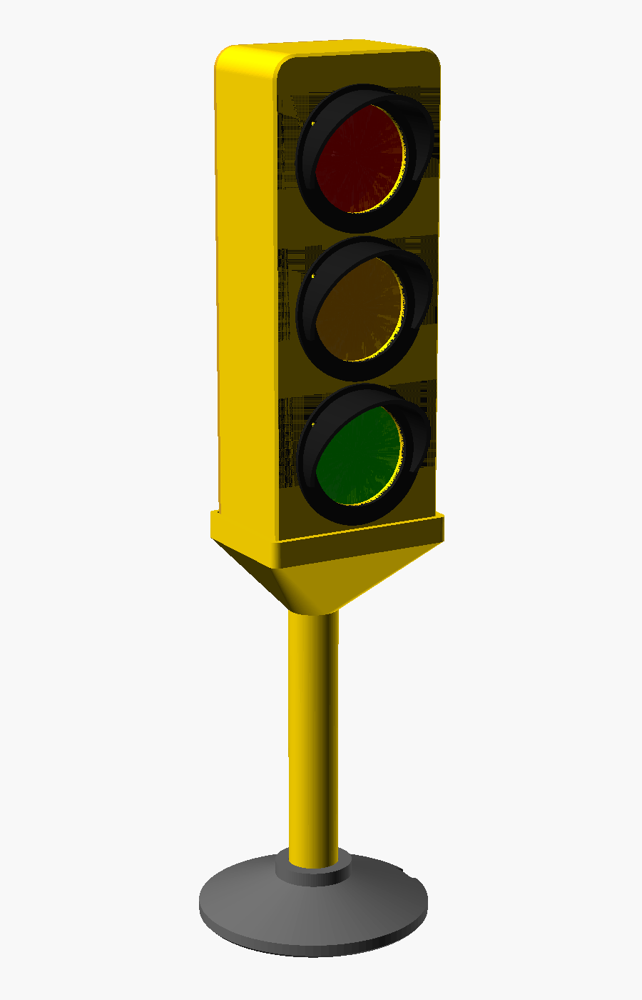
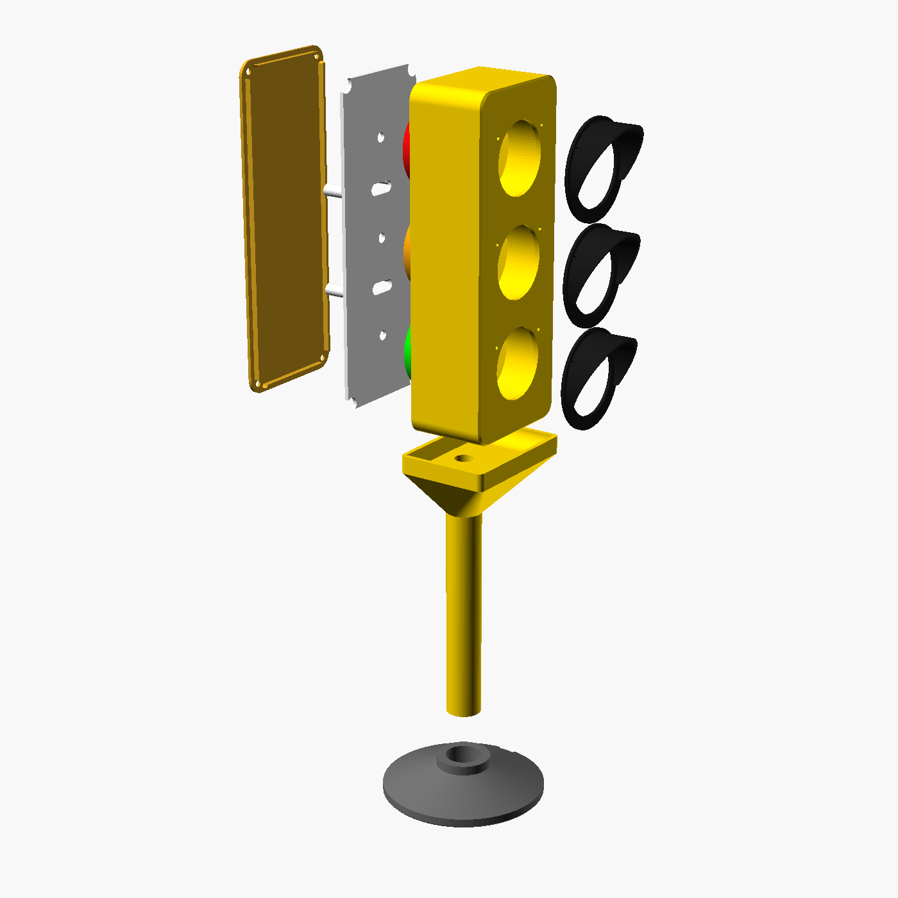
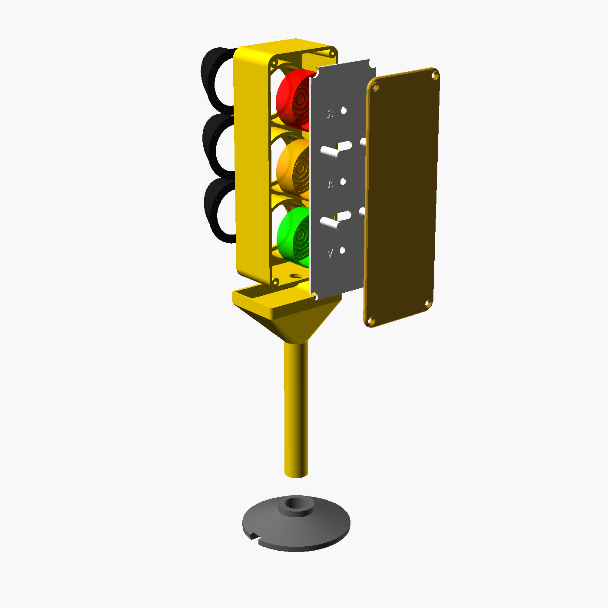

# Semáforo para imprimir en 3D (LEDs de Arduino)



Semáforo de unos 30 cm de alto, en 7 piezas que se imprimen sin soportes. Lleva 3 LEDs de 5 mm, cada uno en su propio tubo para que la luz no pase de un color a otro, y un hueco detrás para los cables y las resistencias. Los cables bajan por dentro del mástil y salen por debajo de la base.

| Vista explotada | Por detrás |
|---|---|
|  |  |

## Piezas (`stl/`)

| Pieza | Cantidad | Color recomendado | Notas de impresión |
|---|---|---|---|
| `cuerpo.stl` | 1 | Amarillo o negro | Con la cara frontal sobre la cama (como sale) |
| `tapa.stl` | 1 | Igual que el cuerpo | Cara lisa sobre la cama |
| `soporte_leds.stl` | 1 | Cualquiera (blanco refleja mejor) | Plano, con los postes hacia arriba |
| `lente.stl` | 3 | Blanco o translúcido (PETG/PLA natural) | Boca arriba. Una con filamento rojo/naranja/verde translúcido queda aún mejor |
| `visera.stl` | 3 | Negro | De pie, sobre el aro |
| `mastil.stl` | 1 | Igual que el cuerpo | De pie, con la copa arriba. Brim recomendado |
| `base.stl` | 1 | Negro o gris | Plana |

Ajustes: capa de 0,2 mm, 3 perímetros, relleno 15–20 %. Las lentes, con 2 perímetros y relleno 100 % para que difuminen de forma uniforme.

## Material

- 3 LEDs de 5 mm (rojo, ámbar/amarillo y verde) o 3 LEDs blancos si las lentes son de color.
- 3 resistencias de 220 Ω.
- 4 tornillos M3 × 10 de cabeza avellanada (se roscan en el plástico).
- 6 trozos de filamento de 1,75 mm de unos 8 mm (pines de las viseras).
- Cable fino (4 hilos: R, A, V y GND), unos 50 cm.
- Pegamento instantáneo (opcional, para viseras y base).

## Montaje

1. **LEDs:** mete cada LED en el soporte desde la cara de los postes (la de las letras R / A / V); el aro del LED hace de tope. Una gota de cola caliente lo fija.
2. **Cableado:** suelda en el lado de los postes una resistencia a la pata larga (+) de cada LED y une las tres patas cortas (−) en un solo cable de GND. Las ventanas del soporte sirven para pasar cables de un lado a otro.
3. **Cables al mástil:** pasa los 4 hilos por el agujero de la pared inferior del cuerpo, luego por la copa y el mástil, y sácalos por la ranura de debajo de la base.
4. **Lentes:** mete las 3 lentes en los tubos del cuerpo, con la cara lisa hacia el frente.
5. **Cierre:** pon el soporte de LEDs encima de los tubos (LED rojo arriba) y cierra con la tapa y los 4 tornillos. Los postes del soporte hacen que la tapa lo apriete todo, y no hace falta pegar nada.
6. **Viseras:** mete un trozo de filamento en cada agujero pequeño del frente, encaja la visera y corta lo que sobre. Una gota de pegamento si quieres que no se mueva.
7. **Mástil:** encaja el cuerpo en la copa y el mástil en la base (a presión o con una gota de pegamento).

## Conexión al Arduino

| Luz | Pin | Recorrido |
|---|---|---|
| Rojo | D2 | D2 → 220 Ω → pata larga del LED rojo |
| Ámbar | D3 | D3 → 220 Ω → pata larga del LED ámbar |
| Verde | D4 | D4 → 220 Ω → pata larga del LED verde |
| GND | GND | Las tres patas cortas juntas |

El programa de ejemplo está en [`arduino/semaforo/semaforo.ino`](arduino/semaforo/semaforo.ino): verde 5 s, ámbar 2 s y rojo 5 s.

## Cambiar medidas

Todo sale de [`semaforo.scad`](semaforo.scad) (OpenSCAD). Arriba del todo están los parámetros: tamaño del cuerpo, `led_d` (agujero del LED; pon 10.2 para LEDs de 10 mm), `holgura` (súbela a 0.35 si las piezas entran muy justas), largo del mástil, etc. Para regenerar una pieza:

```bash
openscad -D 'pieza="cuerpo"' -o stl/cuerpo.stl semaforo.scad
```

Pon `pieza="montaje"` o `pieza="explotado"` para ver el conjunto.
